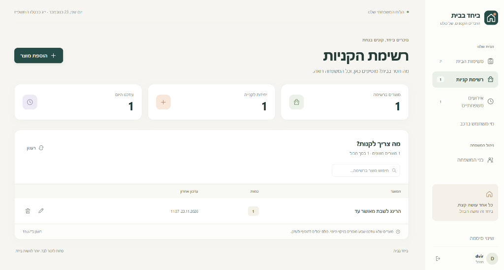
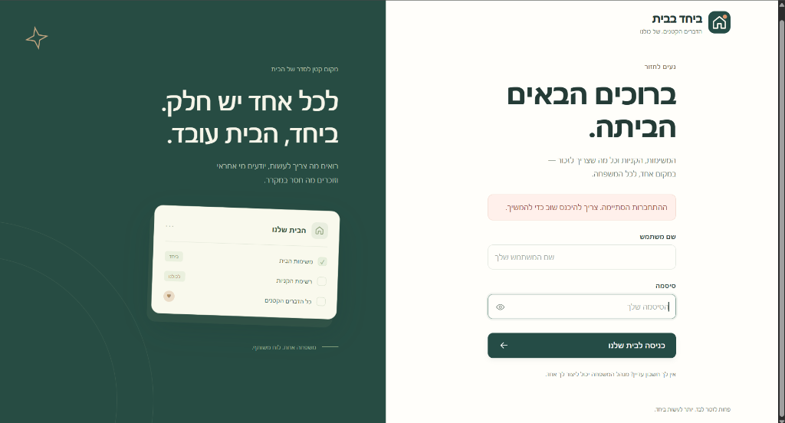
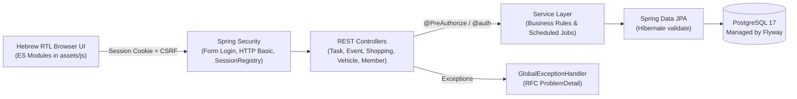
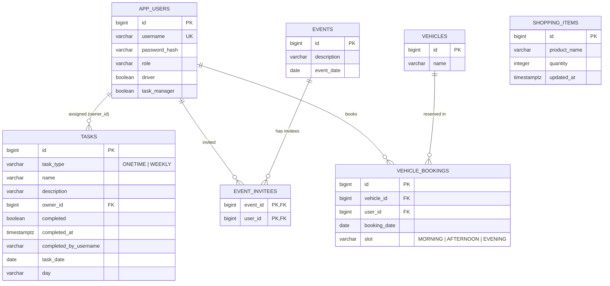

# Family Home

**Family Home** is a shared household management application built with **Java 25, Spring Boot 4.1.2, Spring Security, Spring Data JPA, Flyway, and PostgreSQL**, paired with a lightweight, Hebrew right-to-left (RTL) ES-module browser UI served directly by Spring Boot. It brings together household tasks (with a weekly completion leaderboard), shared shopping lists, family events, member/role management, and conflict-safe vehicle slot bookings.

> **Note:** Built as a backend-focused portfolio project emphasizing layered architecture, role/flag-based authorization, Flyway schema management, concurrency safety, and automated testing.

### Screenshots

| Main Dashboard (Shopping List) | Login Page |
| :---: | :---: |
|  |  |

---

## Quick Start (Docker)

The fastest way to run the full stack (PostgreSQL 17 + Spring Boot app) is with Docker Compose:

```powershell
docker compose up --build
```

Then open **`http://localhost:8080`** and sign in with the default initial administrator credentials from `docker-compose.yml`:

- **Username:** `admin` (configurable via `APP_ADMIN_USERNAME`)
- **Password:** `AdminPass123!` (configurable via `APP_LOGIN_PASSWORD`)

### Running Locally on Windows (Maven Wrapper + PostgreSQL)

Prerequisites: **JDK 25**, **PostgreSQL**, and **PowerShell** (Node.js is optional, for running the JS tests).

1. Create a PostgreSQL database named `family_tasks` (defaults in [application.properties](src/main/resources/application.properties): `localhost:5432`, user `postgres`).
2. On the **first run against an empty database**, set the initial administrator password in PowerShell (`app.admin.username` defaults to `admin`):

   ```powershell
   $initialSecret = Read-Host "Choose initial application password" -AsSecureString
   $env:APP_LOGIN_PASSWORD = [System.Net.NetworkCredential]::new("", $initialSecret).Password
   ```

3. Start the server (prompts for `DB_PASSWORD` without saving it to disk):

   ```powershell
   powershell.exe -NoProfile -ExecutionPolicy Bypass -File .\start-server.ps1
   ```

4. Open `http://localhost:8080/` and sign in.

### Building an Executable JAR

```powershell
.\mvnw.cmd package
```

Run the generated JAR (`target/family-home-0.0.1-SNAPSHOT.jar`) with `DB_PASSWORD` (and `APP_LOGIN_PASSWORD` on an empty database):

```powershell
$dbSecret = Read-Host "Enter PostgreSQL password" -AsSecureString
$env:DB_PASSWORD = [System.Net.NetworkCredential]::new("", $dbSecret).Password
java -jar .\target\family-home-0.0.1-SNAPSHOT.jar
```

---

## Features

- **Tasks & Weekly Leaderboard:** Shared board supporting **one-time tasks** (with specific dates and overdue indicators) and **weekly recurring tasks** (reset automatically every Sunday at midnight `Asia/Jerusalem`). Includes search, filters, completion tracking, and a weekly bar chart leaderboard (`GET /tasks/statistics/weekly`).
- **Shopping List:** Collaborative list where any signed-in member can add, update, or remove items. Stale items not updated for 7+ days are automatically cleaned up by a scheduled job.
- **Family Events:** Shared events with Gregorian and Hebrew date display, many-to-many member invitees (`event_invitees`), and daily cleanup of events older than 30 days.
- **Vehicle Bookings:** Driver-only monthly calendar with `MORNING`, `AFTERNOON`, and `EVENING` slots per vehicle, protected against double-booking at the database level. Only administrators who are also drivers can add or delete vehicles.
- **Member & Security Management:** Independent `ADMIN` / `MEMBER` roles plus `driver` and `taskManager` flags, self-service password changes (BCrypt), admin promotion, and safe user deletion (unassigning tasks, removing invitee links, and canceling bookings).
- **Responsive Hebrew RTL UI:** Modular vanilla ES modules (`src/main/resources/static/assets/js/`) with mobile-friendly layouts, cards, and dialogs.

---

## Architecture & Data Model

### System Architecture



### Entity-Relationship Diagram



---

## Technical Decisions & Trade-offs

- **Session Auth + CSRF vs. Stateless JWT:** Uses server-side HTTP sessions with `SessionRegistry` and CSRF protection (`GET /csrf`) instead of JWTs. This keeps credentials out of browser storage (`localStorage`) and allows immediate server-side session invalidation when permissions change.
- **Post-Commit Session Expiration:** When an admin promotes or deletes a user, or a user changes their password, active sessions are expired *after* the database transaction commits so concurrent requests cannot observe stale permissions.
- **Single-Table Inheritance for Tasks:** `BaseTask` uses `SINGLE_TABLE` inheritance (`task_type`: `ONETIME` / `WEEKLY`) in `tasks`, avoiding joins on the main task board while keeping type-specific fields cleanly modeled in Java.
- **Database Unique Constraint for Booking Races:** Vehicle double-booking is prevented by a database-level unique constraint (`unique_vehicle_slot` on `(vehicle_id, booking_date, slot)`) rather than application-level locking alone; conflicting concurrent requests are mapped to `409 Conflict`.
- **Flyway + `ddl-auto=validate`:** Schema changes are versioned in `src/main/resources/db/migration/` (`V1__init.sql`) with Hibernate set to `validate`, ensuring the JPA model and SQL schema cannot silently drift. *(Note: if upgrading a legacy database created earlier with `ddl-auto=update`, drop and recreate the schema or baseline Flyway manually until a legacy migration is added.)*
- **Paged API Responses & `ProblemDetail`:** List endpoints (`/tasks`, `/events`, `/shopping-items`) return Spring Data `Page<...>` JSON (`@PageableDefault(size = 50)`), and domain/validation errors return standardized `ProblemDetail` responses via `GlobalExceptionHandler`.

---

## API & Permissions

- Full permissions matrix, endpoint table, and JSON request examples: **[docs/api-and-permissions.md](docs/api-and-permissions.md)**
- Interactive OpenAPI / Swagger UI is planned in the Roadmap below.

---

## Testing

Run the Java test suite (uses the `test` profile with H2 and mocked/isolated contexts — no PostgreSQL instance required):

```powershell
.\mvnw.cmd test
```

Run the standalone Node.js frontend tests (built-in Node modules, no `npm install` needed):

```powershell
node .\src\test\js\vehicle-calendar.test.cjs
node .\src\test\js\frontend.test.cjs
```

Java code formatting is configured with Spotless (google-java-format AOSP):

```powershell
.\mvnw.cmd spotless:check
```

---

## Project Structure

```text
├── docs/
│   └── api-and-permissions.md   # Permissions matrix, endpoint list, request examples
├── src/
│   ├── main/
│   │   ├── java/com/familyhome/
│   │   │   ├── event/           # Events, many-to-many invitees, daily cleanup
│   │   │   ├── exception/       # Domain exceptions & GlobalExceptionHandler (ProblemDetail)
│   │   │   ├── member/          # Accounts, passwords, promotion, deletion, flags
│   │   │   ├── security/        # WebSecurityConfig, AuthService (@auth), CSRF, bootstrap
│   │   │   ├── shopping/        # Shopping items & stale-item cleanup
│   │   │   ├── task/            # One-time/weekly tasks, statistics, maintenance
│   │   │   └── vehicle/         # Vehicles, booking slots & driver checks
│   │   └── resources/
│   │       ├── application.properties
│   │       ├── db/migration/    # Flyway SQL migrations (V1__init.sql)
│   │       └── static/          # Hebrew RTL pages, CSS, and ES modules under assets/js/
│   └── test/
│       ├── java/                # Unit, JPA repository, security, and MockMvc API tests
│       ├── js/                  # Node.js tests for ES modules & vehicle calendar
│       └── resources/           # application-test.properties
├── docker-compose.yml           # PostgreSQL 17 + app container setup
├── Dockerfile                   # Multi-stage JDK 25 build -> JRE 25 runtime
├── IMPROVEMENT_PLAN.md          # Engineering backlog & agent guidelines
├── pom.xml                      # Spring Boot 4.1.2, Flyway, Spotless
└── start-server.ps1             # Local Windows runner prompting for DB_PASSWORD
```

---

## Roadmap

Tracked in [IMPROVEMENT_PLAN.md](IMPROVEMENT_PLAN.md):

- **Correctness & Data Model:** Restore deterministic default sorting on `/shopping-items`, `/tasks`, and `/events`; handle pagination cleanly in the frontend; pass injected `Clock` into task completion; add Flyway migration path for legacy schemas; add DB indexes and length constraints.
- **API & Architecture Polish:** Return DTOs (`VehicleResponse`, `BookingResponse`) from `VehicleController`; centralize current-user lookup in `AuthService` and timezone config in `TimeConfig`; use bulk JPQL updates/deletes in scheduled maintenance jobs.
- **Developer Experience & Showcase:** GitHub Actions CI (`mvnw verify` + Node JS tests), OpenAPI / Swagger UI (`springdoc-openapi`), JaCoCo test coverage reporting, PostgreSQL Testcontainers integration test, and live demo deployment.
